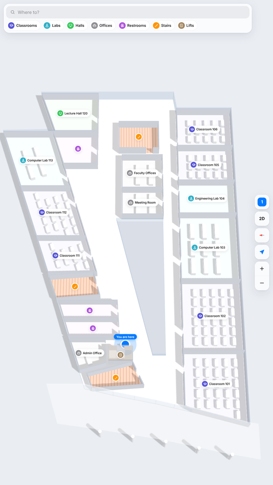
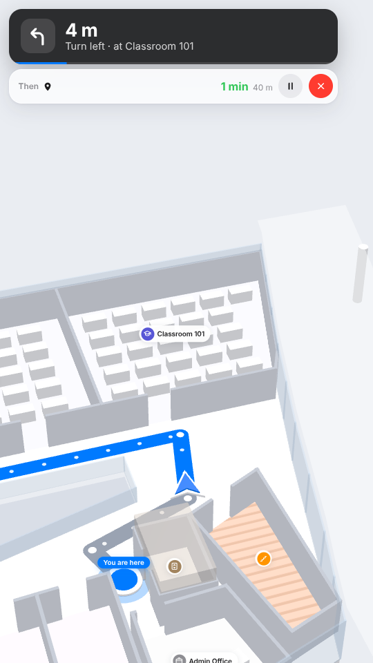
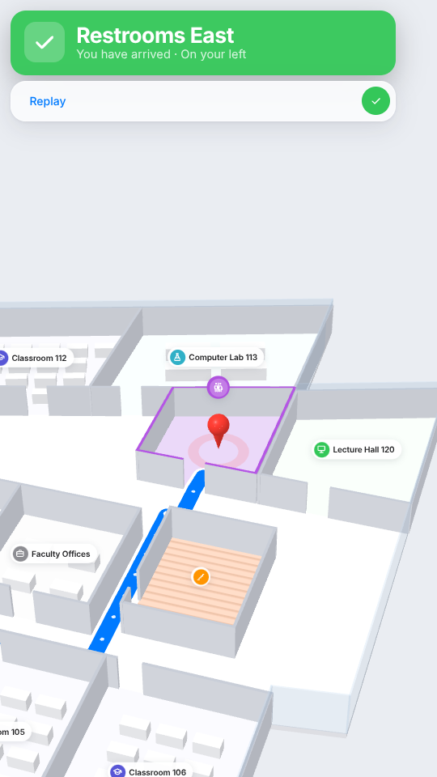
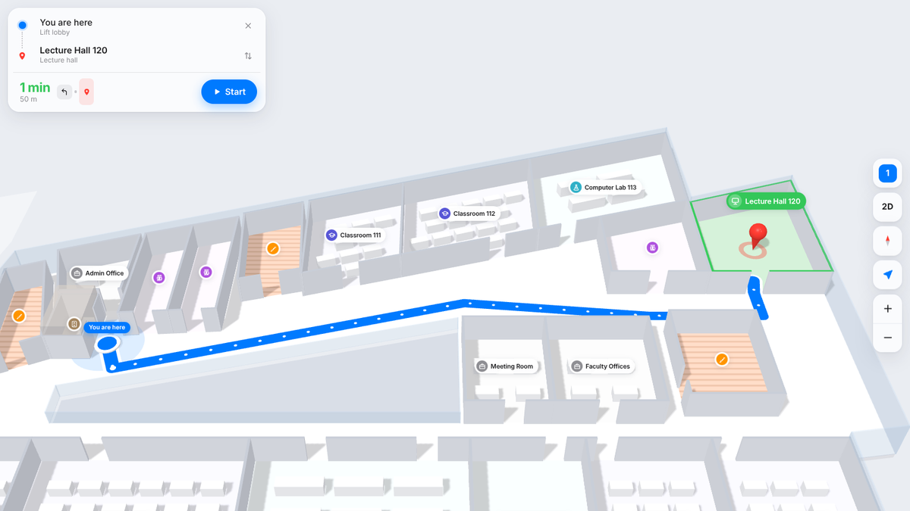

# Campus Navigator

Indoor 3D navigation for the digital totems in the College of Engineering & IT (1st floor).
It is a web app. Open it in a kiosk browser (for example Fully Kiosk Browser) and it looks like a native app.

- 3D map of the floor (Three.js). Tap **2D** for a flat, top-down map.
- Search or tap a category (Classrooms, Labs, Restrooms, Stairs …), or tap a room on the map.
- The route shows at once: time, distance and the turns.
- **Start** plays an immersive preview: the camera follows a blue arrow along the route with turn-by-turn
  instructions, like the Google Maps 3D navigation view. At the end, the camera circles the destination.
- You can change the start point (**From**) and swap start and destination.
- Kiosk mode: after 60 s with no touch, the app resets and the map turns slowly.

<p>
  
  
  
</p>


## Run it

**Simplest:** open `dist/index.html`. It is one file with everything inside, so it works from a USB stick,
from `file://`, or from any static web host. No internet is necessary.

**For development:**

```bash
cd campus-nav
npm start            # serves http://localhost:8080 (needs python3)
npm install && npm run build   # rebuilds dist/index.html after you change src/
```

## Set up a totem

1. Copy `dist/index.html` to the device, or host the `campus-nav` folder (GitHub Pages works).
2. In Fully Kiosk Browser, set **Start URL** to the file or URL. Add the totem ID, for example
   `index.html?kiosk=k2`.
3. Turn on fullscreen and disable the address bar in the kiosk browser.

URL options:

| Option | Example | What it does |
| --- | --- | --- |
| `kiosk` | `?kiosk=k2` | Which totem this is. Sets the "You are here" point. Totems are in `src/data.js`. |
| `heading` | `&heading=90` | Direction the person faces when they read the screen (0 = north, 90 = east). The map turns so that "ahead" is up, and the first instruction says "Head to your left" etc. |
| `mode` | `&mode=2d` | Start in 2D. |
| `idle` | `&idle=120` | Seconds before the reset. `0` = never. |
| `lite` | `&lite` | No shadows, for slow devices. |

On a tall (portrait) screen without a `heading`, the map turns 90° so the long building fills the screen.

## Change the map

All floor data is in **`src/data.js`**: room shapes, doors, names, corridors and totem positions.

- The coordinates were traced from the evacuation-plan photo, so they are approximate.
  One plan unit = 0.1 m.
- **The room names are placeholders** (Classroom 101, Computer Lab 103 …). Replace them with the real names.
- To add a room: add a `poly` (corners), one or more `doors` (points on its edge) and a `type`.
  Each door connects to the nearest corridor automatically.
- To add a totem: add an entry to `KIOSKS`.

## Files

| File | Contents |
| --- | --- |
| `src/data.js` | Floor plan data |
| `src/geo.js` | Walking graph, shortest route (Dijkstra), turn-by-turn steps |
| `src/scene.js` | 3D scene, labels, route line, camera moves, immersive preview |
| `src/app.js` | Interface and app states |
| `src/styles.css` | iOS-style light theme |
| `vendor/three` | Three.js r170 (MIT), kept local so the app works offline |
| `build.mjs` | Makes the single-file `dist/index.html` |

## Next steps

- Add the other floors (the data format is per floor; stairs and lifts would connect them).
- Put the real room names and check the shapes against the CAD plan.
- A QR code that sends the route to a phone.
